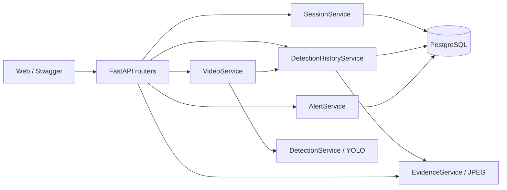
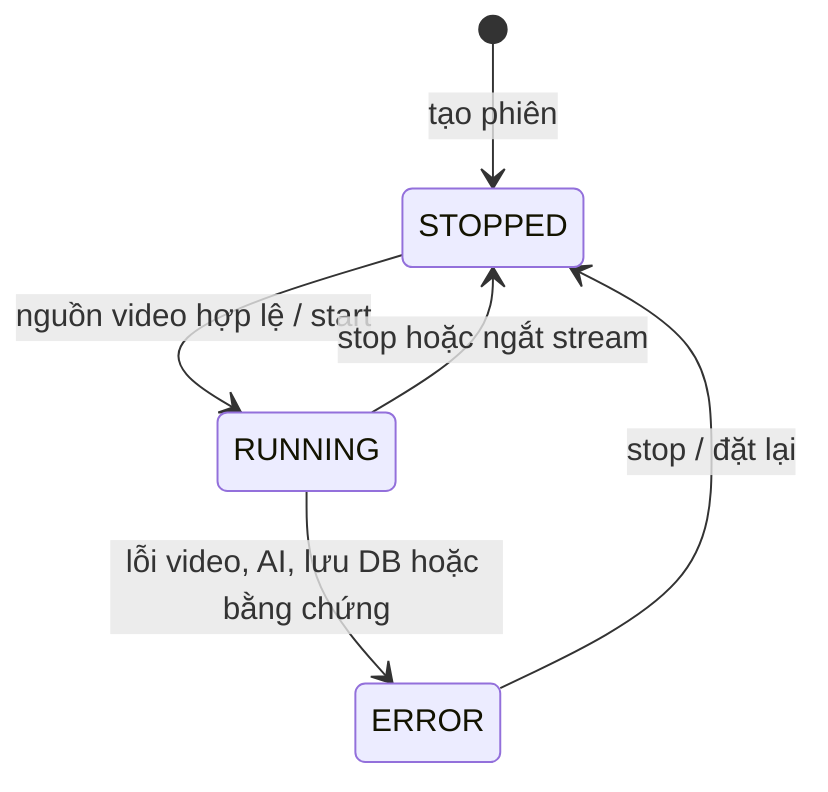
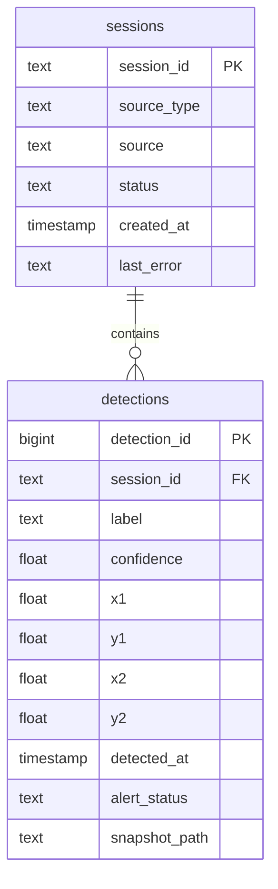

# Thiết kế backend

## Phạm vi và tác nhân

Người vận hành tạo/chọn phiên, mở giám sát, xem lịch sử và ảnh, rồi xác nhận hoặc đánh dấu cảnh báo sai. Nguồn camera được mô phỏng bằng webcam/video trên laptop. FastAPI điều phối nghiệp vụ; PostgreSQL lưu dữ liệu lâu dài; YOLO11n là dịch vụ nhận diện tích hợp.

## Phân lớp

Router kiểm tra request và ánh xạ mã HTTP. Service quản lý quy tắc nghiệp vụ và transaction. Kết nối DB lấy cấu hình từ môi trường hoặc `.env`; SQL sử dụng tham số cho dữ liệu người dùng.

## Vòng đời phiên

Một lần chuyển trạng thái giữ khóa `SELECT ... FOR UPDATE` trên phiên. Hai yêu cầu bắt đầu đồng thời chỉ có một yêu cầu thành công; yêu cầu còn lại nhận 409.

`start` kiểm tra khả năng đọc nguồn và chuyển trạng thái. Trình duyệt mở API monitor để backend bắt đầu đọc/nhận diện. Đây là giám sát gắn với kết nối Web, chưa phải tác vụ nền chạy độc lập khi trình duyệt đóng.

VideoService giữ token sở hữu stream trong một tiến trình. Token cũ không được giải phóng stream mới. Camera đang được sử dụng không được mở bởi một monitor khác. Phiên chưa giải phóng stream không được khởi động lại ngay, tránh luồng cũ tác động phiên mới.

## Dữ liệu

Schema mới có khóa ngoại, CHECK cho trạng thái/nhãn/confidence/bbox, và index phục vụ kiểm tra cooldown, lọc cảnh báo và liệt kê phiên. Thời gian được lưu theo UTC; Web hiển thị giờ Việt Nam. Script khởi tạo bổ sung cột/index vào DB cũ và không xóa dữ liệu; không tự sửa dữ liệu hoặc thay toàn bộ constraint cũ.

## Ghi phát hiện và bằng chứng

1. Kiểm tra nhãn, confidence hữu hạn trong [0,1], bounding box hợp lệ.
2. Mở transaction, khóa bản ghi phiên.
3. Nếu phiên đã dừng: bỏ qua batch; không ghi sự kiện.
4. Với mỗi nhãn: kiểm tra sự kiện trong 5 giây gần nhất; bỏ qua sự kiện trùng.
5. Tạo detection, ghi JPEG qua tệp tạm rồi thay thế tệp hoàn chỉnh.
6. Ghi đường dẫn ảnh trong cùng transaction; commit khi cả batch thành công.
7. Nếu có exception: rollback DB và dọn các JPEG đã tạo trong batch.

Khóa phiên dùng chung với thao tác stop và với các luồng ghi khác, nên stop thành công trước thì không có ghi muộn; hai writer không cùng vượt qua kiểm tra cooldown. Cooldown gom sự kiện theo nhãn/phiên, không phải theo từng vật thể.

DB và filesystem không có transaction phân tán: nếu tiến trình bị tắt ngay giữa lúc ghi ảnh và commit, có thể còn ảnh không liên kết. Cơ chế hoàn tác hiện tại xử lý các exception thông thường; chưa có tác vụ dọn ảnh mồ côi sau sự cố tiến trình.

## Tra cứu và duyệt cảnh báo

API lịch sử hỗ trợ phiên, nhãn, trạng thái, thời gian và limit/offset. Tên cột/điều kiện do backend định nghĩa, giá trị lọc truyền bằng tham số SQL. Count và dữ liệu trang đọc trong cùng snapshot PostgreSQL.

Cập nhật cảnh báo dùng `UPDATE ... RETURNING`. Chỉ chấp nhận ba trạng thái NEW/CONFIRMED/FALSE_POSITIVE; ID không tồn tại trả 404. API ảnh kiểm tra đường dẫn nằm trong thư mục evidence trước khi trả JPEG.

## Lỗi và khả năng vận hành

| HTTP | Trường hợp |
| --- | --- |
| 400 | Đường dẫn bằng chứng/nguồn cũ không hợp lệ |
| 404 | Không có phiên, detection, video hoặc ảnh |
| 409 | Chuyển trạng thái sai hoặc stream/camera đang được sử dụng |
| 413 | Ảnh gửi lên vượt 10 MB |
| 415 | Content-Type ảnh không được hỗ trợ |
| 422 | Request/bộ lọc sai hoặc nguồn video không đọc được |
| 503 | DB/schema chưa sẵn sàng hoặc dịch vụ nhận diện ảnh gặp lỗi |
| 500 | Lỗi chưa dự kiến; trả thông báo chung và request ID |

Lỗi sau khi stream đã gửi HTTP 200 không thể đổi mã HTTP. Backend ghi log, chuyển phiên thành ERROR và kết thúc stream; Web kiểm tra trạng thái phiên mỗi 2 giây để hiển thị lỗi và cho phép đặt lại.

`/health` là kiểm tra tiến trình; `/health/ready` truy vấn các cột cần thiết của DB và kiểm tra tệp model. Readiness không chạy suy luận thử.

Phạm vi triển khai hiện tại là ứng dụng local, một worker. Xác thực nhiều người dùng, phân quyền, UAV/RTSP thật và worker phân tán là phần mở rộng, chưa thuộc bản demo này.
